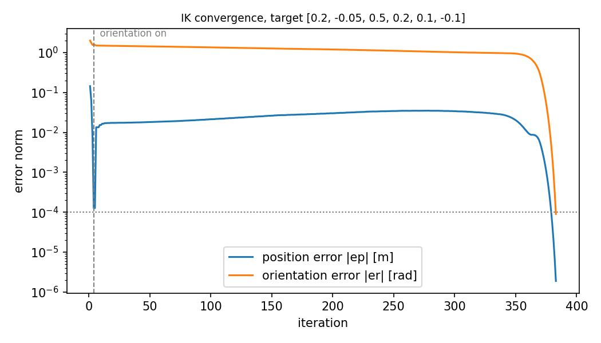

# Numerical IK for the Niryo Ned2

A small, dependency-light inverse kinematics solver for the 6-DOF Niryo Ned2 arm, written from scratch in NumPy. You give it a target pose `[x, y, z, roll, pitch, yaw]` and an initial guess, and it returns joint angles that put the flange there.



## What's in here

| File | What it does |
|---|---|
| `ned2_ik.py` | DH model, forward kinematics, geometric Jacobian, and the IK solver |
| `DH_TABLE.md` | The Ned2 DH parameters, joint limits and a zero-pose sanity check |
| `benchmark.py` | Solves for random reachable poses and reports how many converge |
| `plot_convergence.py` | Plots position and orientation error per iteration (the image above) |

## How it works

**Kinematics.** I modelled the arm with standard DH parameters (see [`DH_TABLE.md`](DH_TABLE.md)). The Jacobian is the geometric one built from the joint z-axes and origins, so its angular part lives in the base frame. I checked it against finite differences of the FK, and the two agree to about 2e-7.

**Solver.** Each iteration does a damped least-squares step

    dq = Jᵀ (J Jᵀ + λ² I)⁻¹ e,   e = [ep ; w·er]

where `ep` is the position error and `er = Log(R_des · R_curᵀ)` is the orientation error as a rotation vector. Around that there is:

- **Adaptive damping**: λ shrinks after a successful step and grows after a failed one, so the solver is aggressive when things go well and careful near singularities.
- **Backtracking line search** with a step size that carries over between iterations: it halves after a bad step and grows by 10% (up to 1) after a good one.
- **Step clamps** on each joint and on the overall step norm.
- **Staged orientation**: it solves position first and adds orientation once the end effector is within 3 mm. Chasing both at once from far away tends to wander into awkward configurations.

## Things that broke and how I fixed them

The first version handled position-only targets fine but basically never converged once orientation was added. It took a few rounds of digging to find out why:

1. **The weight was only on half of the equation.** I was scaling the orientation error by `w` but not the matching Jacobian rows, so the solver was being asked to rotate `w` times the real error and kept overshooting. Worse, in the position-only stage (`w = 0`) it wasn't ignoring orientation. It was asking for zero angular velocity, which pins the wrist. The fix was to weight both sides: `(W J) dq = W e`.
2. **Ping-pong at the 3 mm threshold.** A combined step would often push the position error from 2.9 mm to 3.1 mm. That flipped the solver back to position-only mode, which undid the orientation progress, and the cycle repeated forever. A lot of failed runs sat at almost exactly 3 mm. Once orientation is switched on now, it stays on.
3. **`Log(R)` blew up near 180°.** The textbook formula divides by sin θ, so for a rotation close to π it returned values around 10⁷ instead of π. Near π it now recovers the axis from the symmetric part of R instead.

## Results

Target `[0.2, -0.05, 0.5, 0.2, 0.1, -0.1]` from the zero configuration converges in 383 iterations to 1.9 µm and 9e-5 rad.

On 40 random reachable targets (`python benchmark.py`), starting every solve from q = 0:

| Version | Orientation tolerance | Converged |
|---|---|---|
| Before the fixes | 1e-3 rad | 18 / 40 |
| After the fixes | 1e-4 rad | 32 / 40 |

The median solve takes 18 iterations. The 8 that don't converge are stuck in local minima (raising the iteration limit to 10,000 doesn't help). That's expected for a local, gradient-based solver started far from the answer with joint limits in play. Starting from a nearby configuration, or trying a few random restarts, gets most of them.

## Running it

```
pip install -r requirements.txt
python ned2_ik.py            # solve the example target
python benchmark.py          # convergence benchmark
python plot_convergence.py   # writes convergence.png
```

## Limitations and next steps

- The DH model is my own approximation of the Ned2 and isn't calibrated against the real robot, so expect some millimetre-level differences on hardware.
- Joint limits are handled by clipping, not by building them into the optimisation.
- Ideas I'd like to try: random restarts, a null-space term that keeps joints away from their limits, and checking solutions on the real arm through `pyniryo`.

## Acknowledgment

This project grew out of a numerical IK exercise in a university robotics course, which supplied the starting solver structure and the rotation helpers. I built the kinematic model, debugged and reworked the solver, and wrote the benchmarking and analysis.
